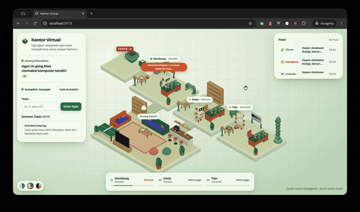

# Virtual Office

Kantor isometrik berisi tim agent pembuat konten yang kerjanya bisa kita tonton langsung.



Tiga agent bekerja berurutan untuk satu topik:

| Agent | Tugas |
|---|---|
| **Bambang** | Riset dan menentukan angle untuk topik |
| **Karjo** | Menulis konten dari hasil riset Bambang |
| **Tejo** | Memublikasikan hasilnya ke X, LinkedIn, Instagram, dan TikTok |

Setiap topik yang masuk disebut **Run**. Hasil kerja satu agent dioper ke agent berikutnya (**Handoff**), dan di akhir Run ada satu **Post** per platform di **Feed**.

> **Catatan:** agent di sini masih **dummy**. Mereka memerankan pekerjaannya dan tidak memanggil LLM sama sekali. Yang diuji adalah alur kerjanya: siapa bekerja kapan, bagaimana hasilnya dioper, dan bagaimana semuanya divisualkan.

## Cara kerja

Project ini terdiri dari dua sisi yang terpisah:

- **Agent service** menjalankan Run beserta seluruh timing-nya, lalu mengumumkan setiap perubahan sebagai event.
- **Visualizer** adalah kantor isometrik (React + Three.js) yang hanya menampilkan apa yang diumumkan Agent service. Lihat [ADR 0001](docs/adr/0001-visualizer-only-projects-agent-events.md).

Struktur monorepo:

```
packages/
  agent-service/   server Hono yang menjalankan Run dan mengirim event (SSE)
  visualizer/      kantor isometrik di browser
  shared/          tipe dan konstanta yang dipakai kedua sisi
```

Istilah yang dipakai di kode dan dokumentasi dijelaskan di [GLOSSARY.md](GLOSSARY.md).

## Instalasi

Butuh Node.js dan npm. Dikembangkan dengan Node.js 22.

```bash
git clone <url-repo-ini>
cd test-agentic
npm install
```

## Menjalankan

Buka dua terminal.

```bash
# Terminal 1: Agent service (port 3001)
npm run dev:service

# Terminal 2: Visualizer (port 5173)
npm run dev:visualizer
```

Lalu buka <http://localhost:5173>.

Port Agent service bisa diganti lewat environment variable `PORT`, misalnya `PORT=4000 npm run dev:service`. Kalau diganti, sesuaikan juga proxy di [vite.config.ts](packages/visualizer/vite.config.ts).

## Contoh penggunaan

1. Buka kantornya. **Autopilot** langsung berjalan dan memilih topik acak dari dunia AI, IT, dan IoT.
2. Perhatikan **Bambang** meriset. Status bubble di atas agent menunjukkan langkah yang sedang dikerjakan.
3. Saat Bambang selesai, hasilnya dioper ke **Karjo**, lalu ke **Tejo**.
4. Setelah Tejo selesai, empat Post (thread, post panjang, carousel, script video) muncul di **Feed**.
5. Ketik topik sendiri untuk masuk antrean. Topik yang tidak termasuk AI, IT, atau IoT akan ditolak.
6. Jeda Autopilot untuk menghentikan Run acak berikutnya. Run yang sedang berjalan tetap diselesaikan.

## Pengembangan

```bash
npm test             # jalankan semua tes
npm run typecheck    # cek tipe semua package
```
